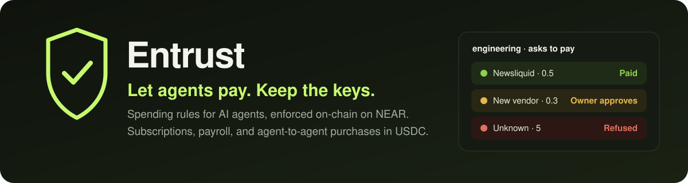
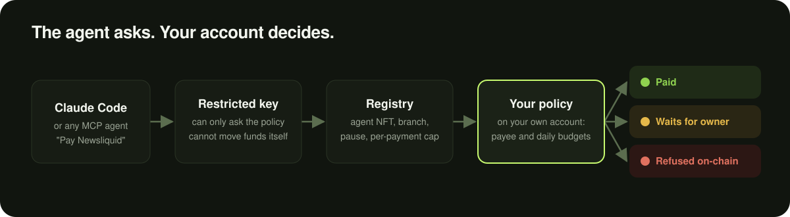

<p align="center">
  
</p>

# Entrust

Entrust lets an AI agent pay vendors from its owner's existing NEAR account under rules enforced on-chain. Each agent is an NFT with its own limits and a restricted key that can only ask. The owner's policy pays approved recipients automatically, holds new ones for one approval, and refuses the rest before money moves. The owner can pause spending or revoke the key at any time.

Built for [NEAR HACKATHON](https://nearhackathon.com/#tracks).

| Demo links | URL |
| --- | --- |
| Hosted dashboard, served on-chain from `entrust.testnet` | [entrust.testnet.page](https://entrust.testnet.page) |
| Public Testnet agent registry | [`agents.entrust.testnet` on NearBlocks](https://testnet.nearblocks.io/address/agents.entrust.testnet) |
| Public demo post on X | [x.com/anjali75619](https://x.com/anjali75619/status/2121720307706900937) |

<p align="center">
  
</p>

## Hackathon tracks

| Track | What Entrust demonstrates |
| --- | --- |
| **NFTs That Do Something** | Each agent is a NEP-171 NFT whose record sets who operates it and what it can request. Child agents can only narrow their parent's limits, and transferring an agent invalidates approvals tied to its previous owner. |
| **Agent Economy** | An agent pays approved vendors, or buys x402 APIs in USDC, without the owner signing each routine payment. The MCP server exposes rules, previews, payments, and activity. |
| **AI Security & Defense** | A function-call key limits the agent to the policy entry point. The owner's contract enforces recipient approvals, per-payment and daily caps, shared budgets, and confirmation thresholds. |

## Try it

### Browser demo (no wallet)

Requires Node.js 24 or later. The demo uses simulated funds.

```sh
npm ci
npm run web:dev
```

Open [localhost:5173](http://localhost:5173/), go to **Try it here**, and connect the demo agent.

| Send | Result |
| --- | --- |
| The prefilled 2 NEAR request | Settles automatically and appears under **Activity**. |
| `Pay ClearCheck 3 NEAR` | **Needs approval**: approve or decline it. |
| `Pay ClearCheck 4 NEAR` | **Blocked**: over the 3 NEAR per-payment limit. |

### Live Testnet

Inspect the public registry at [`agents.entrust.testnet`](https://testnet.nearblocks.io/address/agents.entrust.testnet) without a wallet. Receipts from the earlier deployment, covering payments, refusals, budget exhaustion, and NFT transfer, are in [docs/live_links.md](docs/live_links.md).

### Run your own agent on Testnet

You need Node.js, Rust with the `wasm32-unknown-unknown` target, [cargo-near](https://github.com/near/cargo-near), and a funded Testnet account.

```sh
npm ci
npm run contracts:build
```

Copy `target/near/nearfirewall_registry/nearfirewall_registry.wasm` and `target/near/nearfirewall_account_policy/nearfirewall_account_policy.wasm` into `apps/web/public/`, then run `npm run web:dev`.

1. Connect a wallet, choose **Create my registry**, and register an agent under **Agents**.
2. Under **Payments**, enable payments, approve a recipient, and set the agent's limits.
3. Choose **Connect** on the agent, sign the restricted key, and load the MCP configuration (for Claude Code, set `VITE_MCP_SERVER_PATH` in `apps/web/.env.local` to the absolute path of `packages/mcp/src/main.ts` and paste the command).
4. Ask the agent what it can spend, then to pay the approved recipient. It settles with no owner signature. A request to an unapproved recipient is refused with `RECIPIENT_NOT_APPROVED`, and succeeds after the owner approves it once.

To script the whole setup on a CLI-controlled account instead:

```sh
node scripts/company-demo.ts setup --owner <you>.testnet --payees <payees>.testnet
```

The [Testnet runbook](docs/testnet-runbook.md) has the detailed steps, including the CLI route for local MCP over stdio.

### x402 API payments

An agent can buy an API response in USDC with the `fetch_paid` MCP tool or `POST /api/x402/fetch` on the gateway:

1. The API answers `402 Payment Required` with its price.
2. The buyer asks the owner's policy to fund that exact amount. The policy checks seller rules, caps, and budgets.
3. The buyer signs the USDC transfer and retries. The seller releases the response once its facilitator settles.

The owner sets x402 rules under **Payments → x402 payments (USDC)**: a per-payment cap on the agent NFT, daily budgets, a small shared budget for unapproved sellers, and approved payees (another agent by NFT, a seller account, or a website). `return_unspent_usdc` sends leftovers back.

Wallets that refuse contract deployments (Meteor, for one) can use **Use a one-time setup key**, a temporary key that installs the contract and deletes itself in the same transaction.

`npm test -- packages/x402` runs the buyer, paywall, and facilitator against mocked chain reads. `node scripts/x402-demo.ts setup` prepares two Testnet owners. x402 is verified locally and has not yet run on Testnet.

### Deploy to Vercel

Import the repository with Root Directory `./`; [`vercel.json`](vercel.json) serves the dashboard at `/` and the gateway at `/api`, `/mcp`, and `/health`. Set `NEARFIREWALL_ACCOUNT`, `NEARFIREWALL_AGENT_KEY`, `GATEWAY_TOKEN` (32+ characters), and `PORT=8787`, plus `NEARFIREWALL_NETWORK` for mainnet. For fresh-account setup, add the contract WASM URLs or code hashes from [`apps/web/.env.example`](apps/web/.env.example).

### Host the dashboard on-chain

The policy contract also answers web4 requests, so the owner's account serves the dashboard at `<account>.testnet.page`; the gateway stays on Vercel. Upgrade the policy to the local build, which keeps every rule and connection, then upload the built app to NEARFS and point the account at it:

```bash
npm run contracts:build
node scripts/upgrade-policy.ts <you>.testnet
VITE_POLICY_CODE_HASH=<new policy hash> VITE_MCP_SERVER_PATH= npm run web:build
npx web4-deploy apps/web/dist <you>.testnet --nearfs
```

Only one-level names get a certificate, so use a top-level account such as `entrust.testnet`, not a sub-account.

## How it works

1. **Register.** The owner's registry mints the agent NFT and stores its capabilities and ancestry.
2. **Authorize.** A function-call key limited to `agent_execute` on the owner's account, with zero deposit, is mapped to the agent.
3. **Evaluate.** The registry checks the agent and its ancestors. The owner's contract checks the recipient, budgets, agent generation, and confirmation threshold.
4. **Settle.** Approved payments are sent from the owner's account. Amounts are reserved while a payment is pending and released if it is declined or fails.

A branch of agents can share one budget, and pausing a parent stops its whole branch. See the [implementation plan](docs/implementation-plan.md).

## Tests

```sh
npm test && npm run typecheck && npm run web:build && cargo test --workspace
```

Rust tests cover NFTs, inherited capabilities, stale authorizations, caps, confirmations, and settlement. TypeScript tests cover the SDK, MCP tools, gateway, browser demo, and x402.

## Repository layout

| Path | Purpose |
| --- | --- |
| [`contracts/`](contracts) | Registry, account policy, shared types, and the waitlist |
| [`apps/web`](apps/web) | React dashboard and browser demo |
| [`apps/gateway`](apps/gateway) and [`packages/mcp`](packages/mcp) | HTTP gateway and MCP server |
| [`packages/sdk`](packages/sdk), [`templates`](packages/templates), [`x402`](packages/x402) | Clients, payment plans, and x402 buyer and paywall |
| [`scripts`](scripts), [`deployments`](deployments), [`docs`](docs) | Testnet tooling, records, and documentation |

## Hackathon notes

- **Build window.** Project history starts November 11, 2026, within the [eligible window](https://nearhackathon.com/HACKATHON.md).
- **Libraries.** Rust, `near-sdk`, `near-contract-standards`, React, Vite, TypeScript, NEAR Connect, `near-api-js`, Zod, and the MCP TypeScript SDK. A [third-party Edge notice](third-party/Edge-LICENSE) is included.
- **Contributors.** Anjali Jha ([`@blizet`](https://github.com/blizet)) and Sarthak Dengre ([`@DengreSarthak`](https://github.com/DengreSarthak)).
- **Other entry.** Sarthak Dengre also built the independent project [Nierwall](https://github.com/ConduenceAi/Nierwall).
- **Waitlist.** The landing page's waitlist contract is [`contracts/waitlist`](contracts/waitlist), deployed on Testnet at `waitlist.entrust.testnet`. Set `VITE_WAITLIST_CONTRACT_ID` to use another account.

Entrust is released under the [MIT License](LICENSE), with the Edge notice's BSD 3-Clause terms.
